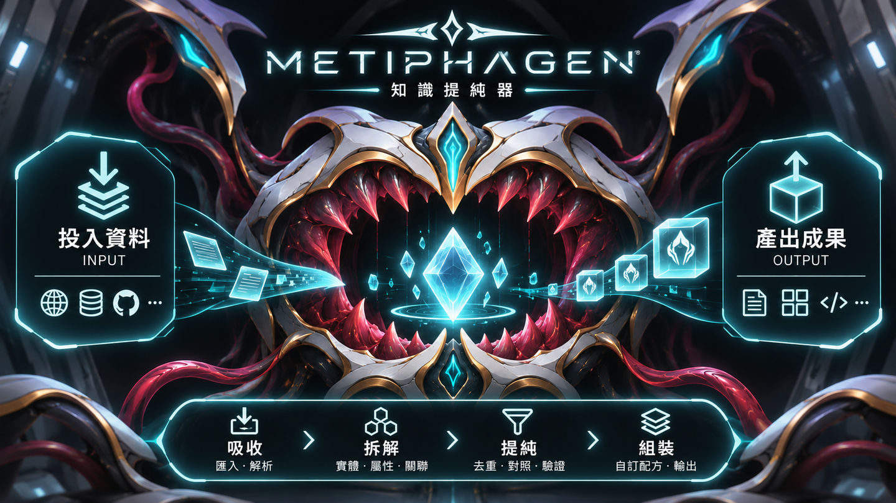

  

<h1 align="center">METIPHAGEN｜提純器</h1>

<strong>吞入資料・提純知識・自由組裝</strong>

> **專案狀態：設計與原型驗證階段。** 以下內容是專案願景與規劃方向，不代表所有功能都已完成。

## 專案介紹

### METIPHAGEN：吞噬混沌、孕育知識的造物

> 在無數散落的紀錄、文件與資料之間，棲息著一隻名為 **METIPHAGEN** 的知識吞噬獸。
> 牠擁有吞入龐雜資訊的巨口，卻不以破壞為目的。每一份投入的資料，都會在牠體內被辨識、拆解與淬鍊，化為具有身分、意義與關聯的**知識結晶**。
> 這些結晶被珍藏於牠的知識典藏之中；當創作者需要時，便可自由挑選、重新鍛造，形成各式各樣的資訊造物。

這隻怪物的靈感來自古希臘神話中的**智慧（Metis）**、**吞噬（Phage）**與**創生（Genesis）**，加上科幻生物機械的視覺語言。METIPHAGEN 是本專案原創的品牌角色與世界觀設定，並非神話中的既有生物，也不是 Warframe 的官方角色。

### 從神話寓意到真正的軟體

**METIPHAGEN**是一套以多來源資料為基礎的**模組化知識工程系統**。牠的「吞噬」對應資料吸收，「消化」對應資料拆解、比對與驗證，而「知識結晶」就是具備穩定識別碼、來源證據及相互關聯的**最小合理知識單元**。

使用者可以自行挑選需要的實體、欄位、圖片及關聯資訊，保存為可重用的**組裝配方**，產出清單、資料包或網站內容，而不必反覆整理同一份資料。

**核心理念：原始資料不因吞噬而消失；知識整理一次，組合使用多次。**

## 怪物的五個領域｜軟體模組命名

METIPHAGEN 的身體與能力，分別對應軟體中的五個功能區域。這些名稱是互動設計與模組職責的隱喻，**不代表必須拆成五個獨立服務**。

| 軟體區域 | 名稱 | 功能 |
| --- | --- | --- |
| **資料入口** | **The Maw（巨口）** | 投入 Wiki、GitHub、API 等來源資料，保留原始內容與出處 |
| **提純核心** | **Metis（智慧）** | 辨識、拆解、去重、建立關聯及驗證候選知識 |
| **知識庫** | **The Codex（知識典藏）** | 保存可追溯的知識單元、事實與相互關係 |
| **組裝工作區** | **The Forge（鍛爐）** | 讓使用者自行選取知識、決定欄位並建立可重用配方 |
| **輸出** | **Creations（造物）** | 產出資訊清單、JSON、網站內容等可重用成果 |